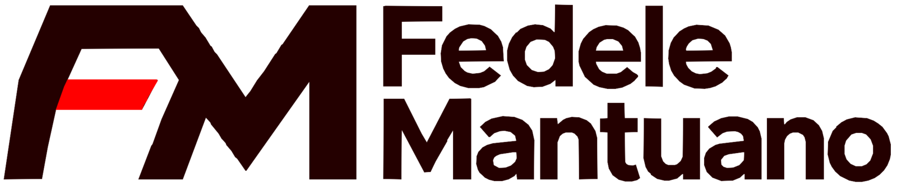
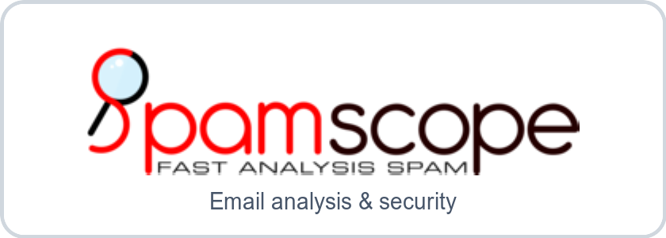
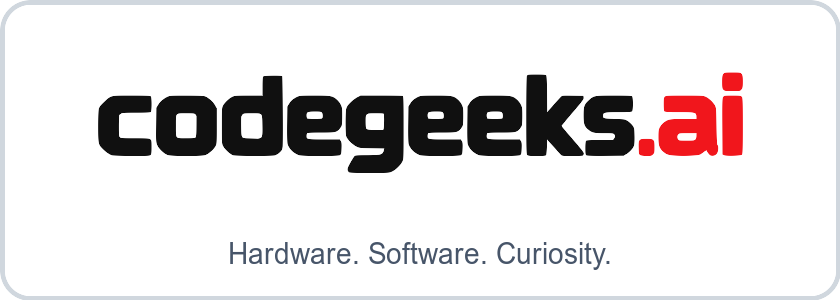

  <a href="https://mantuano.biz">
    <picture>
      <source media="(prefers-color-scheme: dark)" srcset="assets/fedele-mantuano/logo-dark.png">
      
    </picture>
  </a>

  <strong>Security engineer. AI engineer. Creator of SpamScope.</strong> 
  <a href="https://mantuano.biz">mantuano.biz</a>

## About

- In cyber security since 2011: SOC analyst, anti-phishing, incident response, and the platforms behind them.
- Building AI agents, RAG systems and MCP servers, and studying how AI changes security work.
- Automating with Python, Elasticsearch and Ansible.

## Projects

  
  

- [SpamScope](https://spamscope.ai/en/): email analysis and security. Its core library, mail-parser, is downloaded more than 3 million times a month and ships in Debian, Arch Linux and FreeBSD.
- [CodeGeeks](https://codegeeks.ai/en/): electronics, software, security and applied AI, explained and built in the open.
- [Tabletop Assistant](https://tabletopassistant.com/): an AI assistant that answers board game rules questions.
- [Malware reverse engineering with AI](https://github.com/CodeGeeksAI/malware-reverse): defensive malware analysis with AI agents and Ghidra.

## Tech Stack

## Contact

- Website: [mantuano.biz](https://mantuano.biz)
- Email: [fedele@mantuano.biz](mailto:fedele@mantuano.biz)
- LinkedIn: [fmantuano](https://www.linkedin.com/in/fmantuano)
- X: [@fedelemantuano](https://x.com/fedelemantuano)
